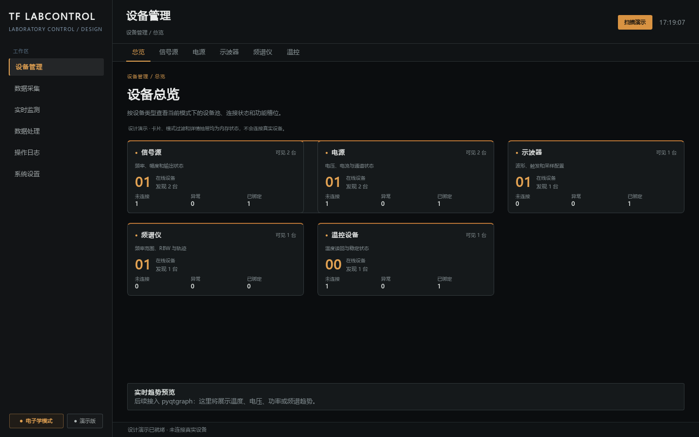

# 已确认的前端基线：深色琥珀分类卡片版

2026-09-23，用户要求查找历史卡片版，在看到历史提交 `0ae6721` 的 `MainWindow + OverviewPage + DeviceCard + dark.qss` 实际渲染图后确认：**“是图上这个”**。

## 固定外观

- 以本页截图为准：黑色背景、灰白文字、琥珀色卡片顶边与数字、左侧导航、顶部分类标签、侧栏底部模式和真实/演示标识。
- 首页以分类卡片为主体，宽窗口三列；每张卡片显示类别、描述、可见数、在线数、未连接、异常和已绑定数量。缩窄窗口时变为两列或一列。
- 首先保留信号源、电源、示波器、频谱仪、温控设备五类入口。其他已有设备类别按库存增加卡片；光学模式补充光学测量入口。不能因切换模式而丢失已有设备。
- 点击分类卡片打开右侧设备池，选择设备后使用已有连接、控制、监测和范围刷新功能。首页不放整页设备表或四格统计条。
- 底部保留实时趋势区域，接入已有实时监测入口；当前统计使用会话快照，不显示历史 Mock 数量。

## 代码与入口

共用运行窗口为 `src/lab_control/ui/real_window.py`，分类卡片为 `ui/widgets/category_cards.py`，唯一运行主题为 `ui/styles/card_workspace.qss`。控制、监测、数值输入和弹窗沿用相同配色。

`lab-control`、`run_real.bat`、`python -m lab_control` 和 `python -m lab_control.app` 使用真实 ApplicationRuntime；显式演示入口使用隔离 Mock 服务。启动、浏览卡片和打开设备池不自动连接或读写仪器。保留前端限幅、后端严格校验及会话能力快照。

历史 `ui/main_window.py`、`overview_page.py`、`device_card.py` 与 `dark.qss` 是视觉来源，保留供比对，不重新启用仅有 Mock 的旧业务实现。`design/directions-v2/01-command-center.html` 的表格方向不是此次确认基线。

后续新增设备和功能延续这套分类卡片布局与配色。未经用户明确调整方向，不把首页改为表格或其他视觉方案。
