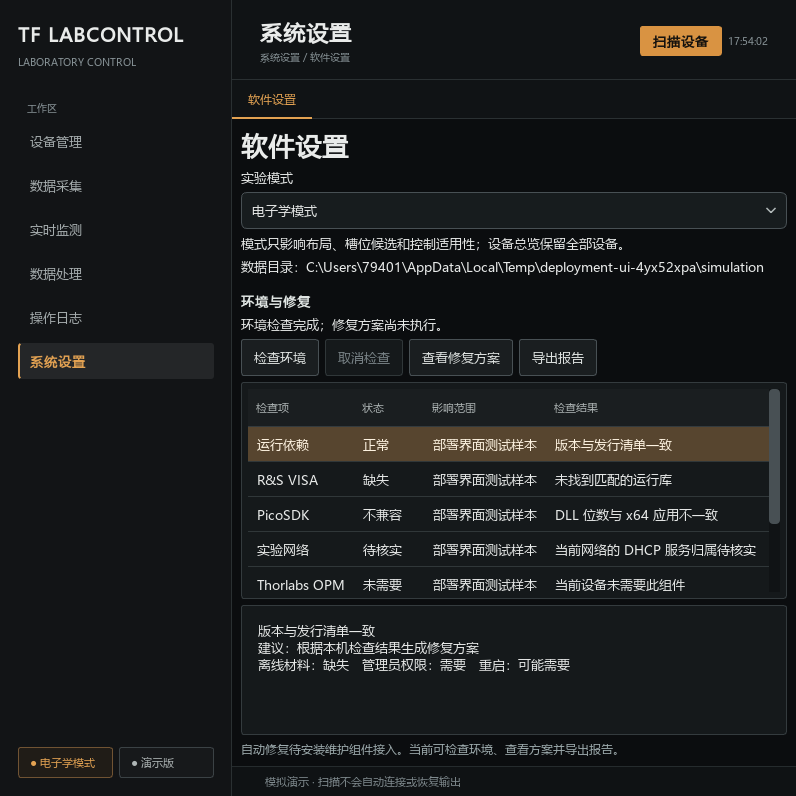

<!-- docs: historical -->
# 桌面部署与环境修复验收（2026-09-25）

本记录对应[桌面部署与环境修复](../development/desktop-deployment.md)本轮实现。范围为开发规则、组件台账、打包与设置内检查；没有安装驱动、修改网卡、防火墙或 DHCP，也没有访问真实仪器。

## 本轮已验证

| 项目 | 结果与证据 |
| --- | --- |
| 软件回归 | `python -m pytest -q -m "not hardware"`：1340 passed，1 deselected，183.70 秒；实机测试未执行 |
| 开发台账检查 | 登记覆盖通过；新增运行依赖、型号组件引用和运行时第三方导入受检查 |
| 严格发布检查 | 按预期返回退出码 1；安装方法、分发依据、部分离线组件和目标电脑验收未齐备，不能发布正式安装包 |
| 既有安装材料 | VISA、PicoSDK、Thorlabs 三份缓存通过哈希与签名核验；未执行安装 |
| 实际 EXE | 固定 PyInstaller 构建完成；整个目录复制到源码外，在中文及空格路径、隔离数据目录和清理后的 PATH 下通过自检 |
| 冻结资源 | Qt 界面、深色琥珀主题、字体、运行版本元数据及六个已注册型号可加载 |
| CSV 后台任务 | 源码与冻结真实子进程成功转换；损坏输入返回失败和状态报告，原始二进制保留；未创建硬件锁 |
| 设置页 | 后台检查、逐项状态、取消及部分结果、异常重试、修复方案和 JSON 导出通过；执行器未接入提示明确 |
| 公共环境服务 | 实际读取本机组件及网络状态；无法确定 DHCP、规则或版本兼容性时保持待核实 |
| 网络方案 | 已有 DHCP、独立实验网、多网卡、其他接口/VPN 网段冲突、换网卡、跨电脑旧方案和恢复快照变更均有回归 |
| 静态及文档检查 | 新增核心模块的 Ruff/Mypy 通过；本轮较早快照的生成检查及 120 份 Markdown 检查通过。最终复查受并发新增型号的缺失维护源阻断，详见下文 |

最终测试 EXE SHA256：`4ebd14e97e1a3a4d3817c81ed59d8567e4b9902faac64c18a0aa0ed852106d1d`。产物位于 `dist/TF-LabControl`，需要整个目录；构建记录、版本清单及自检 JSON 在本机忽略目录保存，不提交二进制产物或机器信息。

构建中发现并修复了开发机 PATH 混入其他软件 ICU DLL 导致 Qt 无法加载的问题：构建子进程使用受控 PATH，spec 拒绝项目解释器及 Windows 目录以外的原生库。冻结环境的 CSV worker 经统一启动分发入口运行，不进入 GUI 初始化。

最终文档复查时，工作区的并发修改新增了 WaveRunner 9404M 注册；其包内 `README.md`、`hardware/README.md` 和 `hardware/records.py` 尚未存在，导致生成检查及 121 份 Markdown 检查报错。本轮保留这些进行中的修改，未补写未经验证的型号资料。上述 EXE 和 1340 项回归对应此前六个注册型号的快照；新型号完成后需另行生成文档、回归并构建。

## 界面检查

以下为 800 × 800 离屏渲染，列表使用明确标记的测试状态样本。检查了按钮、状态、原因和详情区域的可读性；它不是实机驱动检测结论。

## 自动执行待实现

- 正式离线安装器、管理员维护进程，以及应用不能启动时的独立维护入口。
- 驱动安装、网络/DHCP/防火墙修改、执行前会话互斥、逐项读回、回滚与重启后继续。
- 各组件完整分发材料、已验证安装参数、检测版本规则，以及安装缓存的写入和补齐。

## 目标电脑与实机待验收

本轮源码外测试仍在开发机上进行，并且 GUI 为离屏运行。仍需在干净 Windows 10/11 x64 电脑上完成离线安装、普通权限运行、修复、升级、卸载和数据保留验证；不同网卡、既有 VISA/驱动组合及实际设备接口也须分别留档。检查成功或方案生成均不等于自动修复或设备验收成功。
