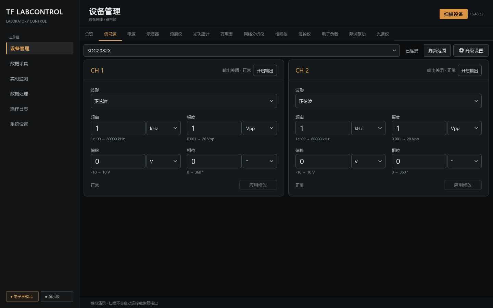
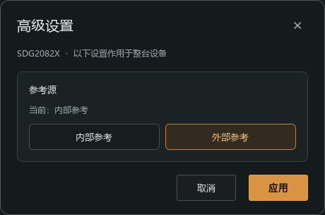

# 电子学模式信号源界面验收（2026-09-24）

本轮使用正式 Qt 页面、唯一深色琥珀主题和隔离 Mock 会话，覆盖 SDG2082X、AFG31252、DG5504 Pro、SMA100B。没有打开真实 VISA 资源，没有切换真实仪器参考源。截图和软件测试不能证明外部参考锁定或物理输出性能。

## 当前界面

最小客户区固定 1280×760，默认 1440×900，工作区适配不再降低最小尺寸。双通道固定并排；四通道采用两列网格，纵向滚动访问下两通道。波形独占一行，频率／幅度、偏移／相位两行对齐，通道顶部集中输出状态与独立操作。射频源仅展示自身支持的频率和 dBm 功率。

参考源由顶部齿轮“高级设置”进入，使用整机弹窗和独立临时草稿；主卡片草稿保持。选中外部参考而尚未应用时，当前值仍显示内部参考。取消、关闭、设备或模式切换丢弃未应用选择。实际读回未知时不默认选中内部参考，应用失败不自动重发。

相位默认显示度；AFG31252 的弧度范围、读回、草稿与提交按同一换算系数处理。电子学页面不创建隐藏的高级编辑器或订阅它们；其他模式保留高级分组。原始高级能力和历史记录保留，仪器模式不会被界面自动改变。

## 渲染与视觉检查

由 [review_electronic_source.py](../../scripts/review_electronic_source.py) 在独立进程设置 Qt 的 100%／125%／150% 缩放。每档同时渲染 1280×760、1440×900，以及 1600×1000 逻辑工作区上的最大化窗口。使用 `QWidget.grab()` 截取实际页面；独立弹窗按真实逻辑坐标叠加，不重画控件。所有运行数据位于临时目录。

| 缩放 | 最小窗口 | 默认窗口 | 弹窗与菜单 | 四通道／射频 | 最大化 |
| --- | --- | --- | --- | --- | --- |
| 100% | 通过 | 通过 | 通过 | 通过 | 通过 |
| 125% | 通过 | 通过 | 通过 | 通过 | 通过 |
| 150% | 通过 | 通过 | 通过 | 通过 | 通过 |

逐张检查标签、数字、单位、按钮、边框、留白与焦点。主卡片输入左右对齐，无横向溢出；菜单选项完整且位于工作区内；参考源弹窗居中、按钮等高。四通道页面在滚动边界处截取上一行内容属于正常滚动行为，下两通道的参数与应用按钮均可完整到达。离屏环境的键盘焦点、Escape 关闭及弹窗定位有自动化断言；未将离屏渲染描述为 Windows 实桌面人工验收。

截图目录：[100%](../../design/reviews/electronic-signal-source/dpi-100/)、[125%](../../design/reviews/electronic-signal-source/dpi-125/)、[150%](../../design/reviews/electronic-signal-source/dpi-150/)。每档包含双通道、四通道顶部／底部、射频、焦点、波形菜单、参考源弹窗及最大化共 17 张截图，另有 `metrics.json` 保存实际卡片几何与滚动范围。





## 自动化覆盖与协议契约

- UI 回归覆盖五参数白名单、逐通道提交、相位换算、主卡片草稿保护、整机参考源单次提交、取消零写入、未知读回、能力缺失、异常／不确定／拒绝不重发、断线、设备与模式切换、首次页面无独立控件闪现，以及原有高级分组回归。
- SDG2082X 型号包增加 `ROSC?`、`ROSC INT/EXT`，解析有／无响应头和可选 `10MOUT`；错误回复不伪造内部参考。写入夹具验证仅发送源选择和读回，不写 `10MOUT` 或通道模式命令。
- 型号原始 `capabilities-before.json` 保留；扩展后契约保存于 `capabilities-current.json`，型号 README 和派生能力文档同步更新。
- 全项目 pytest：720 通过、1 跳过（实机测试默认跳过）。Ruff、格式检查、Mypy、文档生成一致性和文档链接检查通过；离线构建及 wheel 独立导入／逐型号移除检查通过。

复现渲染：

```powershell
.venv-dev\Scripts\python.exe scripts/review_electronic_source.py --dpr 1
.venv-dev\Scripts\python.exe scripts/review_electronic_source.py --dpr 1.25
.venv-dev\Scripts\python.exe scripts/review_electronic_source.py --dpr 1.5
```

本轮结论限于软件和界面验收；SDG2082X 参考源硬件控制仍待单独实机验证。
