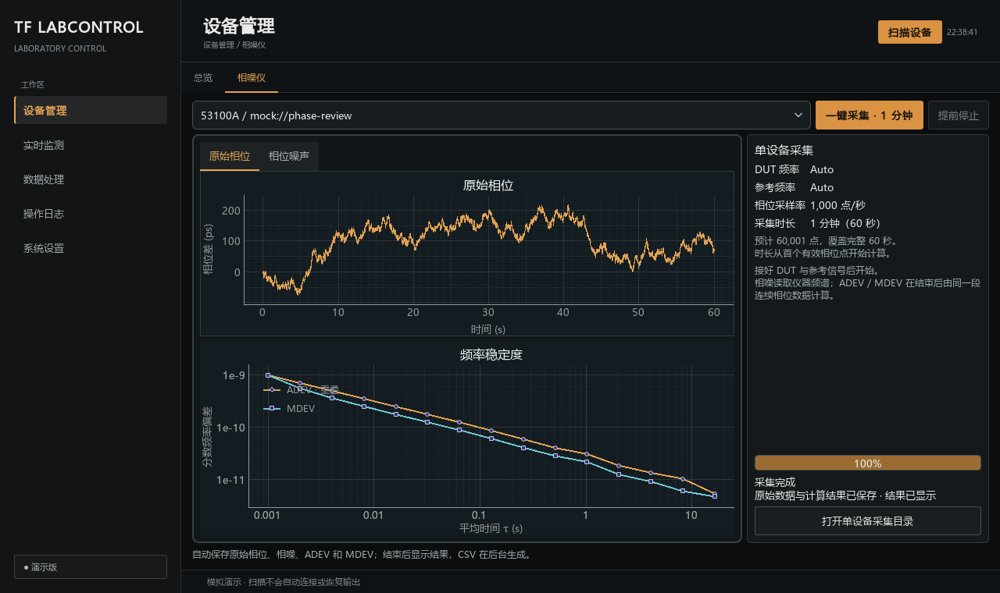

<!-- docs: historical -->
# 相噪仪一分钟采集（2026-11-05）

本批将 53100A 有限采集移入设备管理，固定 DUT/参考 Auto、1000 点/秒和 60 秒。主界面及分类卡片沿用深色琥珀基线；未改变设备扫描、真实身份或锁策略。现行操作见[使用指南](../guides/control-and-monitoring.md#相噪仪定时采集)。

## 数据与验证范围

使用型号模拟器和公共会话、分段记录器及 CSV 转换。验证一分钟对应 60,001 个相位点，原始相位、相噪、ADEV、MDEV 均保存到“单设备采集”；隐藏页面期间的数据也能在结束后完整显示。提前停止保留部分时段，通信缺口不画成连续曲线。二进制收尾阻止重复开始，CSV 转换不占仪器；旧批次回调不覆盖新结果。

协议回归验证手动频率配置在显式开始时分别切换到 Auto、逐项读回，写入不确定时不启动或重放。导航回归验证实时监测菜单及总览不包含该型号，旧链接转入设备管理；旧采样率/时长偏好不改变固定方案。定向型号、控制页面和嵌入控件回归共 113 项通过。

全项目回归 3114 项通过、1 项跳过；运行时使用独立短临时目录及编号夹名，避免 Windows 深层数据处理输出路径超长，不修改系统策略或产品代码。Ruff、格式检查、Mypy、文档生成一致性及链接/锚点/导航检查通过；复用现有环境离线构建源码包和 wheel，并通过型号模块 wheel 隔离导入及移除检查。通信中断后的完成提示明确 ADEV / MDEV 只对应最后连续数据段。

## 界面检查

通过 `scripts/review_phase_workspace.py` 在 1440×900、1280×760 离屏生成并检查就绪、采集和完成状态，图中均为合成数据。新截图单独保存，不覆盖旧工作区批次。

## 实机边界

本批没有启动真实仪器测量。既有 USB 身份、兼容层连接和服务参数验证不替代带 DUT/参考信号的相噪与稳定度验收；按[型号硬件计划](../../src/lab_control/instruments/devices/microchip_53100a/hardware/README.md)另建批次。没有新增或替换依赖。
