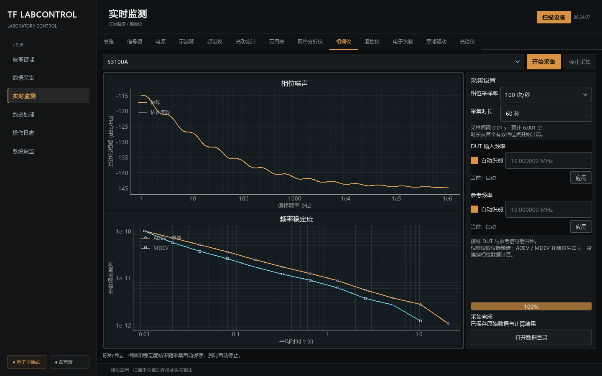

# 相噪仪定时采集工作区（2026-09-29）

本轮软件实现采样率、时长、相噪、重叠 ADEV/MDEV、提前停止和自动保存，沿用正式深色琥珀入口。未连接 DUT/参考，不执行实机 start，不能作为物理性能验收。

## 实现和资料

协议、流校验、范围与稳定度算法位于 [53100A 型号包](../../src/lab_control/instruments/devices/microchip_53100a/README.md)。核对 Microchip DS50002991G §8、已安装官方 TimeLab 1.780A 随包 tserve.cpp 的采样输出、表头和停止行为；公式参考 NIST SP 1065 与 AllanTools 官方说明。无新增第三方包。

## 软件证据

- 型号回归覆盖官方频谱表头、真实 rate 读回、连续时间戳、告警/乱码/非有限值、序列号不符、配置变化、提前停止、停止失败及一次性 start/stop。
- 数值验证包含二次相位的解析解、独立嵌套求和公式、求和项数、m=1 两种偏差相等、线性相位零偏差与短记录不生成曲线。
- 公共会话覆盖自然结束容量释放、缓冲满收尾、失败仍解锁和每帧保存；界面覆盖显式启动、控制禁用、自动/手动频率、结果保留与旧 CSV 回调隔离。
- 全项目 `pytest -q`：2068 passed、1 skipped（209.02 s）。最后增加频谱查询时间和避免重复记为新帧后，型号及有限任务回归 92 passed（6.39 s）；每次实际查询与保存频谱数量匹配，最终结果保留原查询时间。
- Ruff 全项目通过，Mypy 232 个源文件通过；生成一致性零差异，151 份 Markdown 链接/锚点/导航零错误。组件登记检查通过，目录式 PyInstaller 构建及源码/冻结 EXE 的二进制→CSV worker 离线检查通过（均未访问硬件）。这些检查不替代待执行的带信号实测或严格发行验收。

## 界面检查

使用 `scripts/review_phase_workspace.py` 运行正式 RealWindow 与隔离模拟会话，未访问硬件。检查 1440×900 和 1280×760 的设置、采集中和结果页；小窗口设置侧栏可纵向滚动。图上对数轴使用普通科学记数，避免上标字形缺失。

其他状态：[等待开始](../../design/reviews/phase-workspace/phase-ready.png)、[采集中](../../design/reviews/phase-workspace/phase-collecting.png)、[窄窗口](../../design/reviews/phase-workspace/phase-results-1280.png)。

## 未测边界

USB 身份和空闲服务已测的历史结论不扩大到本次采集功能。相位流的四档实机采样率、实际信号告警、长时采集、相噪和 ADEV/MDEV 与 TimeLab 的同数据对照均待按 [硬件计划](../../src/lab_control/instruments/devices/microchip_53100a/hardware/README.md)建立新批次。严格发行仍需厂商再分发许可与干净 Windows 10/11 验证。
