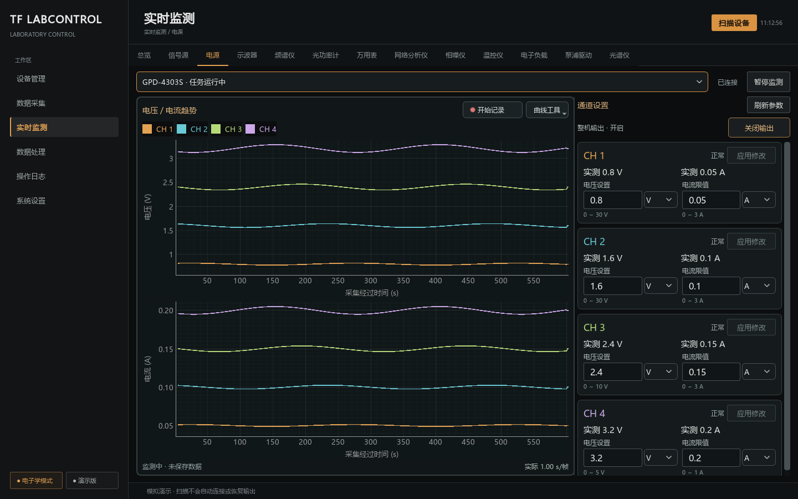

# 电源实时监测与控制整合验收

日期：2026-09-28。使用正式 Qt 页面、公共会话和深色琥珀主题，全部仪器交互为独立临时运行目录中的 Mock。未扫描或操作真实设备，未提交 Git，保留任务开始时已有的未提交修改。

## 当前结论

| 项目 | 结果与边界 |
| --- | --- |
| 工作区与入口 | 左侧上下电压／电流趋势、右侧可滚动紧凑通道控制。电源旧设备管理导航跳转实时监测；设备池隐藏重复的控制按钮，总览继续负责连接和资产。 |
| 间隔 | “曲线工具 → 采集间隔”默认收起，实际帧间隔常驻底部。电源只显示 1、5、10、60 秒，每次启动恢复 1 秒；当前运行按设备／模式共享，切页和重连不重置，不自动开始。其他类别保留各自策略。 |
| 通道 | 默认全选；每周期一个包含所选通道的 scalar 请求，同时供两图、实测数字及逐帧记录使用。修改集合等待在途读取结束，全取消停止；主动暂停取消待续监测意图。 |
| 控制 | 复用参数编辑器、范围及草稿保护；逐通道应用，在控制组内完成核对后续监测。GPD 只有整机输出，IT6322 Mock 验证按通道输出。取消确认零写入，错误不重发。 |
| 缓存与锁 | 稳定监测不插入独立设定查询，提供刷新参数。有效同会话缓存保留原时间，后台暂停不永久禁用输出。记录及二进制排空锁定参数、输出和通道集合。 |
| 显示与保存 | 双图共用真实接收时间轴、通道同色、V/A 单位分离。显示保存固定旧帧和通道，零仪器通信，保留原时间元数据；记录复用公共有界流水线和 5 秒 CSV 转换。 |
| 趋势缩放 | 首个有效点为左侧 0 秒，随后按真实时间差向右增长；初始 0～600 秒，超过后滚动最近 600 秒且不重置原点，手动视窗保留。Y 初始留余量，随后只随新数据越界扩展。手动适配当前可见历史；恒值非零范围，无效数据不补零。普通调参保留历史，换设备／会话清空。 |
| 全项目回归 | 1782 passed、1 skipped；跳过项为需显式设备配置的硬件测试，不计为实机通过。 |
| 工程检查 | Ruff 检查与格式检查通过（380 文件）；Mypy 通过（200 源码文件）；派生文档一致性、文档链接／锚点／导航检查通过。源码包、wheel、独立导入及逐型号移除检查通过。 |
| 桌面构建 | Windows 目录式构建通过。复制到项目外的中文临时路径后，冻结 worker、二进制记录／CSV、GUI 环境页和损坏输入保护自检通过；报告明确 hardware_accessed=false。 |
| 实机边界 | 未验证真实电源的采集吞吐、输出或测量精度；本轮结论限于软件和隔离界面验收。 |

## 回归证据

- [电源工作区跨层测试](../../tests/integration/test_power_workspace.py)：启动覆盖旧偏好、四档选择、跨页共享、单请求双图、静默参数、监测中应用、另一通道草稿、长期缓存、通道排空、暂停优先、全取消、逐帧记录及锁、零通信保存旧帧、读回超时／缺项不重试、重连清空、整机／通道输出与确认取消。整机输出设置和后续核对始终保留同一控制组，结束后才恢复采集。
- [趋势图测试](../../tests/unit/test_power_plot.py)：不规则真实时间、恒值、扩展不收缩、可见历史适配及共享 X、无效帧、缺少量、新会话和取消通道。
- [已连接设备选择](../../tests/integration/test_connected_selection.py)与[分类工作区](../../tests/integration/test_control_workspace.py)：旧路由、新页面、断线清空、总览复用及其他类型不受影响。
- 保留旧 [PowerSupplyPage 回归](../../tests/integration/test_power_panel.py)，直接实例化兼容类检查原有范围、失败和输出规则；新用户路由统一使用新页面。慢磁盘、缓冲满、CSV 失败、排空、时间戳及重复保存继续由公共流水线全项目回归覆盖。

检查命令：`pytest -q`、`ruff check src tests scripts examples`、`ruff format --check src tests scripts examples`、`mypy`、`scripts/generate_device_docs.py --check`、`scripts/check_docs.py`、`uv build --offline --no-build-isolation`、`scripts/check_device_wheel.py`、`scripts/build_desktop.py`、`scripts/check_desktop.py`。本机整合验证输出位于忽略目录 `.tools/power-workspace-20260928/`，收起间隔及从首帧计时的复核位于 `.tools/power-timeline-20260928/`。

## 界面检查

[渲染脚本](../../scripts/review_power_workspace.py)使用 1280×760、1440×900 逻辑尺寸及 100%／125%／150% DPI，生成六组标准布局、四档下拉、输入草稿和滚动底部截图；见[完整截图索引](../../design/reviews/power-workspace/README.md)。逐组检查文字、输入对齐、双轴对齐、滚动可达性和下拉选项，自动验证菜单位于屏幕工作区内、无横向滚动、无实际帧间隔浮窗、未暴露最快模式及新帧不抢输入焦点。补充首帧从左侧零点开始、非规则时间间隔、超过 600 秒后滚动、暂停／手动视窗及间隔展开关闭零通信的回归。

10 分钟曲线使用明确的 Mock 合成历史布局样本，非真实仪器数据，也不作为长时性能结论。紧凑窗口通过右侧滚动访问 CH4；草稿差异只在需要时展开，未改变图形区域。

现行行为见[使用指南](../guides/control-and-monitoring.md)及[公共监测规则](../architecture/live-acquisition.md)。
