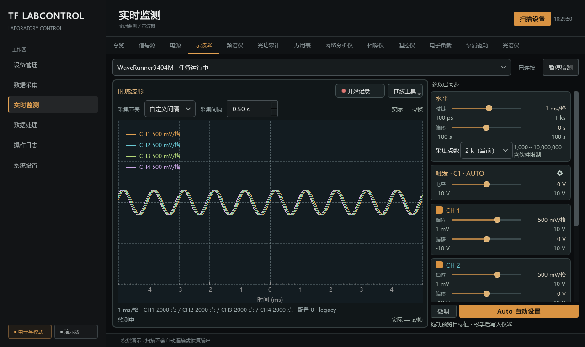

# 启动节奏、Auto 续监测与实际时间验收

日期：2026-09-27。沿用正式 Qt 页面与深色琥珀主题，仪器交互全部使用隔离 Mock。

## 当前结论

| 项目 | 结果与边界 |
| --- | --- |
| 启动节奏 | 示波器和频谱仪每次启动覆盖旧 fastest／其他间隔，恢复 interval／0.5 秒；本次运行的选项按设备和工作模式共享，不自动启动任务或写设置。 |
| Auto | 成功后按实际通道续原监测；明确拒绝但通信正常时保留失败提示、只读核对后续监测，设置只发送一次。用户取消、无通道、原本未监测、通信失败仍保持停止；记录与排空锁不变。 |
| 点数菜单 | 按能力列档位，连续范围有自定义弹窗，离散型号不伪造档位；当前值及超范围状态如实显示。取消零写入，范围刷新不写入。 |
| 实际时间 | 保存读取前后 UTC 及单调耗时，各通道记录波形回包接收时刻；慢写盘不改变时间，记录相对时间不按目标间隔生成。原生触发时间与相对波形轴保留来源。 |
| 格式兼容 | JSON／SQLite／CSV／NPZ 保留时间元数据；NPZ 增加无需 pickle 的 metadata_json。新 CSV 版本 2，旧检查点继续旧表头，无混列或重复帧。 |
| 软件回归 | 全项目 1758 passed、1 skipped；跳过项为显式硬件测试，不计为实机通过。 |
| 工程检查 | Ruff、Mypy（197 个源码文件）、文档生成一致性与 140 篇文档链接检查通过；源码包及 wheel 构建、独立导入和逐型号模块移除检查通过。 |
| 数据库 | 用户随后明确授权测试阶段删除旧坏库；在独占维护锁下备份并重建空白库存／偏好库，再次打开确认完整性正常、三张表均为空。诊断和替换前备份仅存运行目录 diagnostics；采集文件及实机历史保留。 |
| 实机边界 | 本轮未操作真实仪器，未验收 Auto 实机效果、硬件触发时钟或物理精度。 |

## 界面检查

`scripts/review_scope_timing.py` 在 1280×760、1440×900 逻辑尺寸和 100%／125%／150% DPI 渲染正式页面、菜单及自定义弹窗。已检查单行节奏、输入对齐、范围文字、取消行为和无帧率浮窗；紧凑窗口的通道区保留滚动，Auto 与底部状态可见。

## 回归覆盖

- 启动前预存最快／8 秒，重新启动后恢复 0.5 秒；运行内切换、设备和模式隔离、零仪器写入。
- Auto 成功、禁用拒绝、命令执行拒绝、取消续监测、超时、通道变化及记录锁；配置暂态沿用公共 30 秒有界等待。
- 自定义取消、离散非法值零写入、非预设值、范围收缩、原值越界和草稿保护；预览测试隔离合法的空闲后台同步。
- 不规则读取耗时、UTC 回拨、通道顺序接收、保存旧帧、慢磁盘、二进制／CSV 对应、旧检查点和实际波形坐标。

现行规则见[监测调度](../architecture/live-acquisition.md)、[数据模型](../data/data-model.md)和[使用说明](../guides/control-and-monitoring.md)。
